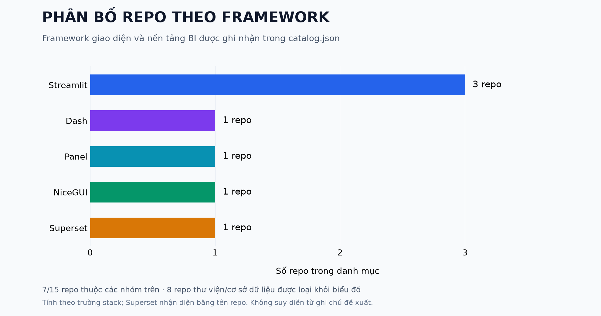

# 📊 Python SQL Dashboard Resources

Tổng hợp repo GitHub phục vụ xây dựng giao diện phân tích dữ liệu bằng Python, kết nối SQL và vẽ biểu đồ bằng Seaborn, Matplotlib cùng các công cụ liên quan.

<p>🐍 Python &nbsp; · &nbsp; 🗄️ SQL &nbsp; · &nbsp; 📈 Seaborn & Matplotlib &nbsp; · &nbsp; 🖥️ Dashboard</p>

## 🎓 Tutorial chi tiết

[Đọc tutorial trên nhánh codex/tutorial](https://github.com/croznnt/python-sql-dashboard-resources/blob/codex/tutorial/tutorials/README.md), gồm cài đặt, SQL, pandas, biểu đồ, giao diện, PostgreSQL, MySQL, kiểm tra và triển khai.

## 🧮 Thực hành NumPy với dữ liệu kho

[Đọc hướng dẫn luồng NumPy](tutorials/numpy-warehouse/README.md) hoặc [tải bộ slide 15 trang](tutorials/numpy-warehouse/Luong_ThucHanh_NumPy.pptx). Bộ thực hành có code Python, database SQLite mô phỏng và bốn CSV mẫu để đối chiếu. Nội dung đi từ SQL đến mảng, broadcasting, chuẩn hóa và so sánh thứ tự ưu tiên theo trọng số.

Chạy tại máy cá nhân theo hướng dẫn trong thư mục `tutorials/numpy-warehouse`. Database được mở chỉ đọc, kết quả lưu riêng trong `ket_qua_numpy`.

## 🧭 Phạm vi

Danh mục phân biệt ứng dụng mẫu, framework giao diện, thư viện biểu đồ và lớp dữ liệu. Không phải mọi repo đều tích hợp sẵn SQL, Seaborn và giao diện. Ghi chú cho biết thành phần cần ghép thêm.

Liên kết và metadata GitHub được kiểm tra ngày 15 tháng 10 năm 2026. Chưa chạy thử từng dự án bên thứ ba. Giấy phép trong bảng lấy từ metadata GitHub; giá trị chưa xác định không đồng nghĩa với không có giấy phép.

## 🧰 Chọn công cụ

1. Học luồng SQL tới biểu đồ: bắt đầu với sql-query-dashboard và ví dụ SQLite trong repo này.
2. Dashboard nhanh: Streamlit, pandas, SQLAlchemy và Seaborn hoặc Matplotlib.
3. Biểu đồ tương tác: Dash cùng Plotly, hoặc Panel cùng Bokeh.
4. Giao diện nhiều điều khiển: NiceGUI và lớp SQL riêng.
5. Nền tảng BI: khảo sát Superset, lưu ý frontend không thuần Python.

## 📊 Thống kê theo framework

### [▶ Mở biểu đồ tương tác](https://croznnt.github.io/python-sql-dashboard-resources/)

Biểu đồ có hiệu ứng chuyển đổi, tooltip, sắp xếp theo tên hoặc số repo, chuyển giữa số lượng và tỷ lệ, bấm vào từng framework để lọc repo và tìm kiếm theo tên hoặc công cụ. Giao diện tự điều chỉnh trên điện thoại.

GitHub README không chạy JavaScript. Dùng liên kết phía trên để tương tác trên GitHub Pages. Biểu đồ thống kê danh mục hiện tại, không thể hiện mức độ phổ biến trên toàn GitHub. Có 7 trong 15 repo thuộc 5 nhóm framework; 8 repo thư viện hoặc cơ sở dữ liệu không nằm trong biểu đồ.

Chạy `python scripts/build_interactive_chart.py` sau khi sửa `catalog.json`, rồi commit và đẩy lên `main` để cập nhật dữ liệu biểu đồ. Trang hoạt động độc lập, không cần CDN hay thư viện JavaScript bên ngoài. Đây là dữ liệu tại lần xuất bản, không tự truy vấn số liệu GitHub theo thời gian thực.

<details>
<summary>Xem ảnh tĩnh dự phòng</summary>



</details>

## 📚 Danh mục

| Repo | Vai trò | Công cụ | Ghi chú | Giấy phép GitHub |
| :--- | :--- | :--- | :--- | :--- |
| [bamoah30/sql-query-dashboard](https://github.com/bamoah30/sql-query-dashboard) | Ứng dụng mẫu | Streamlit, SQLite, Matplotlib | Truy vấn SQL, xem bảng và vẽ biểu đồ. | MIT |
| [CLiang531/data-exploration-app](https://github.com/CLiang531/data-exploration-app) | Ứng dụng mẫu | Streamlit, PostgreSQL, SQLAlchemy | Khám phá dữ liệu và lưu dữ liệu PostgreSQL. Matplotlib và Seaborn có trong phần notebook phân tích, cần kiểm tra riêng với phần giao diện. | MIT |
| [streamlit/streamlit](https://github.com/streamlit/streamlit) | Giao diện | Streamlit | Ghép SQLAlchemy, pandas và st.pyplot để dựng dashboard. | Apache-2.0 |
| [plotly/dash](https://github.com/plotly/dash) | Giao diện | Dash, Plotly | Dashboard có callback; cần bổ sung lớp truy vấn SQL. | MIT |
| [holoviz/panel](https://github.com/holoviz/panel) | Giao diện | Panel | Nhúng biểu đồ phân tích, kết hợp lớp SQL riêng. | BSD-3-Clause |
| [zauberzeug/nicegui](https://github.com/zauberzeug/nicegui) | Giao diện | NiceGUI | Giao diện web bằng Python, tham khảo ví dụ cơ sở dữ liệu của dự án. | MIT |
| [matplotlib/matplotlib](https://github.com/matplotlib/matplotlib) | Biểu đồ | Matplotlib | Vẽ biểu đồ tùy biến. Cần ghép giao diện và lớp SQL. | Chưa xác định |
| [mwaskom/seaborn](https://github.com/mwaskom/seaborn) | Biểu đồ | Seaborn, Matplotlib | Biểu đồ thống kê từ DataFrame đã đọc qua SQL. | BSD-3-Clause |
| [plotly/plotly.py](https://github.com/plotly/plotly.py) | Biểu đồ | Plotly | Biểu đồ tương tác, ghép Dash hoặc Streamlit. | MIT |
| [vega/altair](https://github.com/vega/altair) | Biểu đồ | Altair | Biểu đồ khai báo từ dữ liệu dạng bảng. | BSD-3-Clause |
| [bokeh/bokeh](https://github.com/bokeh/bokeh) | Biểu đồ | Bokeh | Biểu đồ tương tác và ứng dụng server. | BSD-3-Clause |
| [sqlalchemy/sqlalchemy](https://github.com/sqlalchemy/sqlalchemy) | Kết nối SQL | SQLAlchemy | Engine, SQL expression và ORM. | MIT |
| [pandas-dev/pandas](https://github.com/pandas-dev/pandas) | Xử lý dữ liệu | pandas | Đọc SQL thành DataFrame và tổng hợp dữ liệu. | BSD-3-Clause |
| [duckdb/duckdb](https://github.com/duckdb/duckdb) | Cơ sở dữ liệu | DuckDB | SQL phân tích nhúng, tích hợp Python. | MIT |
| [apache/superset](https://github.com/apache/superset) | Ứng dụng BI | Python backend, SQL, React | Nền tảng BI hoàn chỉnh, frontend không thuần Python. | Apache-2.0 |

## 🔄 Luồng dữ liệu

SQL database → sqlite3 hoặc SQLAlchemy → pandas DataFrame → Seaborn hoặc Matplotlib → giao diện Python.

Seaborn và Matplotlib tạo biểu đồ. Streamlit, Panel hoặc NiceGUI cung cấp bộ lọc, bố cục và tương tác ứng dụng. Biểu đồ Seaborn thường hiển thị dưới dạng hình; Plotly và Bokeh hỗ trợ tương tác trực tiếp trên biểu đồ.

## 🚀 Chạy ví dụ

Yêu cầu Python 3.10 trở lên. Dữ liệu doanh thu giả lập được tạo trong SQLite trong bộ nhớ, không cần tài khoản cơ sở dữ liệu.

```powershell
python -m venv .venv
.venv\Scripts\python -m pip install -r requirements.txt
.venv\Scripts\python -m streamlit run examples/streamlit_sqlite/app.py
```

Trên macOS hoặc Linux, dùng `.venv/bin/python` thay cho `.venv\Scripts\python`.

Ví dụ có bộ lọc khu vực, bảng dữ liệu và biểu đồ Seaborn trên Matplotlib. Mã ví dụ là mã mới của repo này. Các khoảng phiên bản trong requirements là ràng buộc cài đặt, chưa phải lockfile đã kiểm thử trên mọi hệ điều hành.

## 🗄️ Mở rộng SQL

Với PostgreSQL hoặc MySQL, dùng SQLAlchemy và driver tương ứng. Đặt thông tin kết nối trong biến môi trường hoặc secrets. Dùng tham số SQL cho giá trị bộ lọc, giới hạn lượng dữ liệu truy vấn và cấp quyền đọc khi dashboard chỉ phục vụ phân tích.

## 🤝 Dữ liệu và đóng góp

`catalog.json` chứa danh mục cùng thời gian push và trạng thái archived tại lần kiểm tra. Thời gian push không tự chứng minh chất lượng dự án.

Để bổ sung, gửi pull request kèm URL gốc, vai trò, công nghệ SQL, giao diện, thư viện biểu đồ và bằng chứng trong README hoặc mã nguồn. Chỉ tổng hợp liên kết và mô tả, không sao chép toàn bộ mã bên thứ ba. Mỗi dự án giữ giấy phép riêng, cần đọc giấy phép tại nguồn trước khi tái sử dụng.

